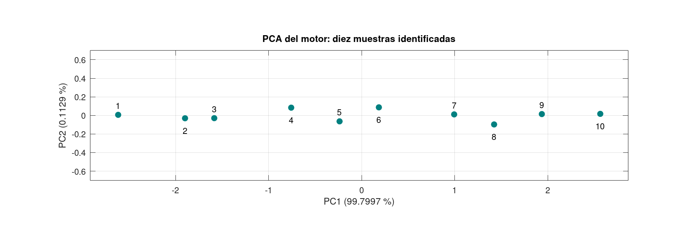

# Taller de reducción de dimensionalidad mediante PCA

Autores: Jimmy Alexander Calderón Trujillo y Sebastián Barahona.

Curso: Métodos Computacionales en Ingeniería.
Docente: Alexander Pérez Ruiz.
Entrega grupal. Implementación en GNU Octave 8.4.0.

## Datos y procedimiento

Se analizaron las diez muestras sintéticas suministradas en el taller.
Las columnas representan temperatura T (°C), corriente I (A) y
vibración V (mm/s). No constituyen un diagnóstico real del motor.

Se estandarizó cada columna mediante Z = (X - media) / desviación,
usando desviación estándar muestral, con divisor n-1.

| Variable | Media | Desviación muestral |
|---|---:|---:|
| Temperatura | 55.5 | 5.01663898 |
| Corriente | 5.9 | 0.53333333 |
| Vibración | 3.08 | 0.63735565 |

## Matriz de covarianza

Se calculó S = Z' * Z / (n-1):

    1.00000000  0.99668324  0.99734336
    0.99668324  1.00000000  0.99695777
    0.99734336  0.99695777  1.00000000

La diagonal es uno porque las variables están estandarizadas.
Los elementos fuera de la diagonal son positivos y cercanos a uno:
las tres variables presentan una relación lineal positiva muy fuerte
en estas muestras. Esto indica redundancia, pero no demuestra causalidad.

## Autovalores y varianza explicada

| Componente | Autovalor | Individual (%) | Acumulada (%) |
|---|---:|---:|---:|
| PC1 | 2.9939896055 | 99.799654 | 99.799654 |
| PC2 | 0.0033881063 | 0.112937 | 99.912590 |
| PC3 | 0.0026222882 | 0.087410 | 100.000000 |

La suma de los autovalores es 3 y coincide con la traza de S.

Los autovectores son las columnas de la siguiente matriz.
Las filas corresponden a T, I y V estandarizadas:

     0.57735742  -0.54870006  -0.60463762
     0.57728298   0.79801742  -0.17295250
     0.57741040  -0.24919159   0.77749648

PC1 combina positivamente las tres variables con pesos similares,
por lo que representa su tendencia de aumento conjunto.

El signo de cada autovector puede invertirse sin cambiar la varianza
explicada ni las distancias entre las observaciones.

## Proyección PC1-PC2

Se calculó Y = Z * A(:,1:2), donde A contiene los autovectores ordenados.

Las muestras 2 y 3 son las más próximas en este plano, con distancia
0.31392587. Las muestras 1 y 10 son las más alejadas, con distancia
5.17948628. Estas distancias son adimensionales.

La escasa dispersión sobre PC2 es consistente con su baja varianza
explicada. Se utilizó igual escala en ambos ejes para representar
las distancias sin exagerar visualmente PC2.

## Recomendación técnica

Se recomienda conservar dos componentes para visualización y análisis
exploratorio: retienen el 99.912590 % de la variabilidad estandarizada
y descartan solamente el 0.087410 %.

PC1 por sí sola ya conserva el 99.799654 %. PC2 permite examinar
pequeñas diferencias respecto de la tendencia principal.

Para monitoreo deben conservarse también las tres mediciones originales.
La reducción no justifica retirar sensores ni eliminar registros:
una falla incipiente podría manifestarse en una dirección de baja
varianza. Se requieren más datos, distintos estados de operación
y validación con fallas conocidas antes de establecer alarmas.

## Preguntas de reflexión

### 1. ¿Qué ocurriría sin estandarizar?

Las unidades y escalas influirían en el resultado. La temperatura tiene
una varianza numérica mucho mayor y tendería a dominar las componentes.
Cambiar amperios a miliamperios también alteraría el PCA sin modificar
el fenómeno físico.

La estandarización permite comparar variaciones relativas. No significa
que las tres variables tengan igual importancia para la seguridad
o el diagnóstico del motor.

### 2. ¿Podría perderse información útil sobre una falla?

Sí. PCA conserva las direcciones de mayor variación estadística,
pero no conoce qué cambios representan una falla.

Una variación pequeña de vibración, diferente de su relación habitual
con temperatura y corriente, podría aparecer en una componente
descartada. Conservar el 99.9 % de la varianza no equivale a detectar
el 99.9 % de las fallas.

## Reproducción y archivos

Ejecutar desde la raíz del repositorio:

    octave --quiet Octave/pca/taller_pca.m

No se requieren paquetes adicionales de estadística.
La exportación de la gráfica requiere un sistema gráfico de Octave.

El programa guarda resultados en datos/pca y la figura en Informe/pca.
Cada ejecución reemplaza los archivos generados.

Los CSV no tienen encabezados:

- datos_motor.csv: columnas T, I, V; filas en orden de muestra.
- estandarizados.csv: columnas T, I, V estandarizadas.
- covarianza.csv: matriz S, orden T, I, V.
- autovectores.csv: filas T, I, V; columnas PC1, PC2, PC3.
- varianza.csv: componente, autovalor, porcentaje individual y acumulado.
- proyeccion.csv: muestra, PC1, PC2.
- resultados_octave.txt: matrices, resultados y verificaciones.

Se verificaron media cero y desviación unitaria de Z, covarianza,
ortogonalidad, ecuaciones de autovectores, suma de autovalores,
covarianza de la proyección y varianza residual de reconstrucción.

## Fuente y asistencia

Fuente: taller_PCA_reduccion_dimensionalidad.pdf, suministrado por el docente.
Se utilizó asistencia de IA para preparar y explicar el código.
Los resultados presentados se obtuvieron mediante ejecución en GNU Octave.
