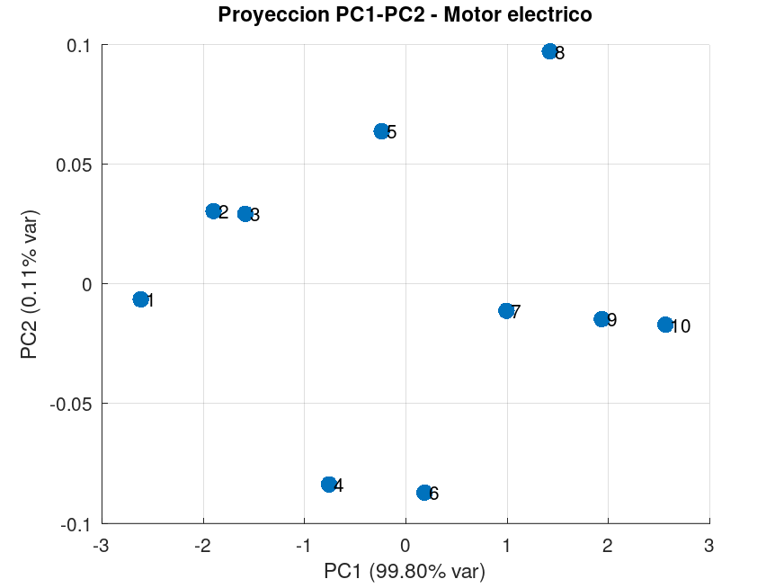

# Taller PCA - Monitoreo de Motor Eléctrico

### Punto 1: Matriz X, medias, desviaciones y Matriz Z

**Matriz X original (10x3):** (Temperatura, Corriente, Vibración)
$$
X = \begin{bmatrix}
48 & 5.1 & 2.1 \\
50 & 5.3 & 2.4 \\
51 & 5.4 & 2.5 \\
53 & 5.7 & 2.8 \\
55 & 5.8 & 3.0 \\
56 & 6.0 & 3.1 \\
58 & 6.2 & 3.5 \\
60 & 6.3 & 3.6 \\
61 & 6.5 & 3.8 \\
63 & 6.7 & 4.0
\end{bmatrix}
$$
*Medias:* \(\bar{T}=55.5\), \(\bar{I}=5.9\), \(\bar{V}=3.08\).
*Desviaciones estándar (muestrales):* \(s_T=5.0166\), \(s_I=0.5333\), \(s_V=0.6374\).

**Matriz Z (Datos estandarizados):**
$$
Z \approx \begin{bmatrix}
-1.495 & -1.500 & -1.538 \\
-1.096 & -1.125 & -1.067 \\
-0.897 & -0.938 & -0.910 \\
-0.498 & -0.375 & -0.439 \\
-0.100 & -0.188 & -0.125 \\
0.100 & 0.188 & 0.031 \\
0.498 & 0.563 & 0.659 \\
0.897 & 0.750 & 0.816 \\
1.096 & 1.125 & 1.130 \\
1.495 & 1.500 & 1.444
\end{bmatrix}
$$

### Punto 2: Matriz de covarianza (S) e interpretación
La matriz de covarianza de las variables estandarizadas (que equivale a la matriz de correlación) es:
$$
S = \begin{bmatrix}
1.0000 & 0.9967 & 0.9973 \\
0.9967 & 1.0000 & 0.9970 \\
0.9973 & 0.9970 & 1.0000
\end{bmatrix}
$$

Los términos fuera de la diagonal son positivos y muy cercanos a 1 (r > 0.99). Esto indica que las tres variables tienen una fuerte correlación lineal positiva entre sí. Hay mucha redundancia en la información capturada por los sensores.

### Punto 3: Autovalores, autovectores y traza
**Autovalores ordenados:**
*   \(\lambda_1 = 2.99399\)
*   \(\lambda_2 = 0.00339\)
*   \(\lambda_3 = 0.00262\)

**Autovectores (Matriz V, columnas = PC1, PC2, PC3):**
$$
V = \begin{bmatrix}
0.5774 & -0.549 & -0.605 \\
0.5773 & 0.798 & -0.173 \\
0.5774 & -0.249 & 0.777
\end{bmatrix}
$$
*Ecuaciones de las componentes:*
*   \(PC1 = 0.5774 Z_T + 0.5773 Z_I + 0.5774 Z_V\)
*   \(PC2 = -0.549 Z_T + 0.798 Z_I - 0.249 Z_V\)

**Verificación de la Traza:**
*   Traza de \(S\) = \(1 + 1 + 1 = 3\).
*   Suma de autovalores = \(2.99399 + 0.00339 + 0.00262 = 3\). 
*   *La suma coincide perfectamente con la traza.*

### Punto 4: Varianza explicada
*   **PC1:** Varianza individual = \(99.80\%\). Varianza acumulada = \(99.80\%\).
*   **PC2:** Varianza individual = \(0.113\%\). Varianza acumulada = **\(99.913\%\)**.
*   **PC3:** Varianza individual = \(0.087\%\). Varianza acumulada = \(100\%\).

### Actividad 5: Proyección PC1–PC2
Gráfico de las 10 muestras proyectadas en el plano de las dos primeras componentes principales:

Las muestras **1 y 10** son los valores extremos. Las muestras **5 y 6** son las más próximas al origen. Se observa una alineación casi perfecta sobre el eje PC1.

### Punto 6: Recomendación técnica
**Se recomienda reducir la dimensionalidad conservando únicamente 2 componentes principales (PC1 y PC2).**

PC1 y PC2 explican el **99.91%** de la varianza; la pérdida es de apenas **0.087%**. Dado que las tres variables originales están altamente correlacionadas, usar 3 variables es redundante. Un plano en 2D (PC1-PC2) facilita la visualización y reduce el costo computacional sin perder capacidad de diagnóstico.